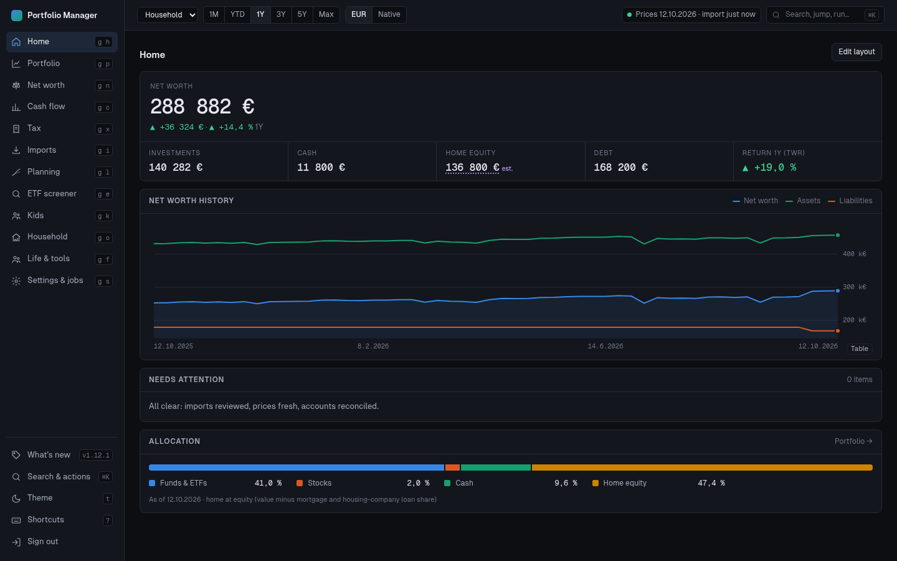
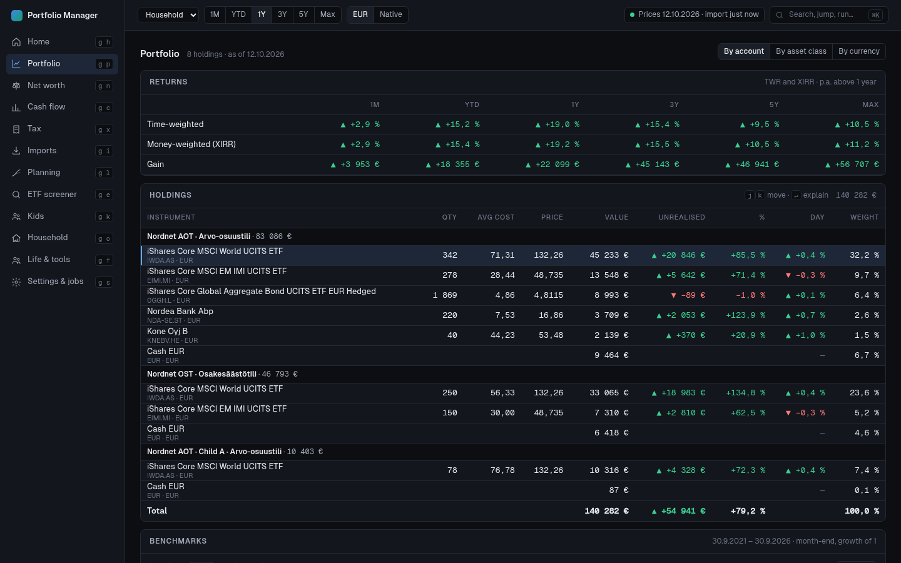
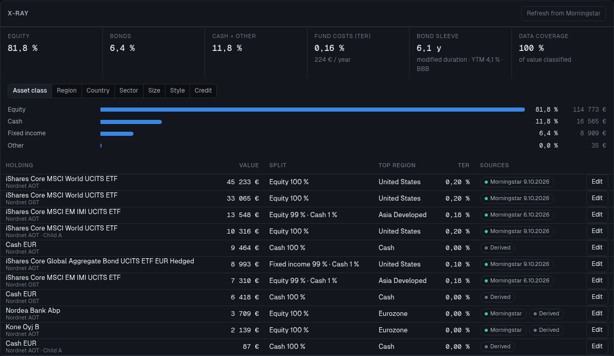
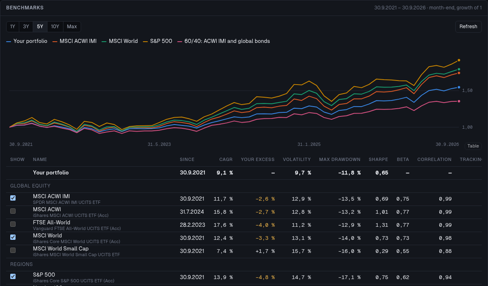
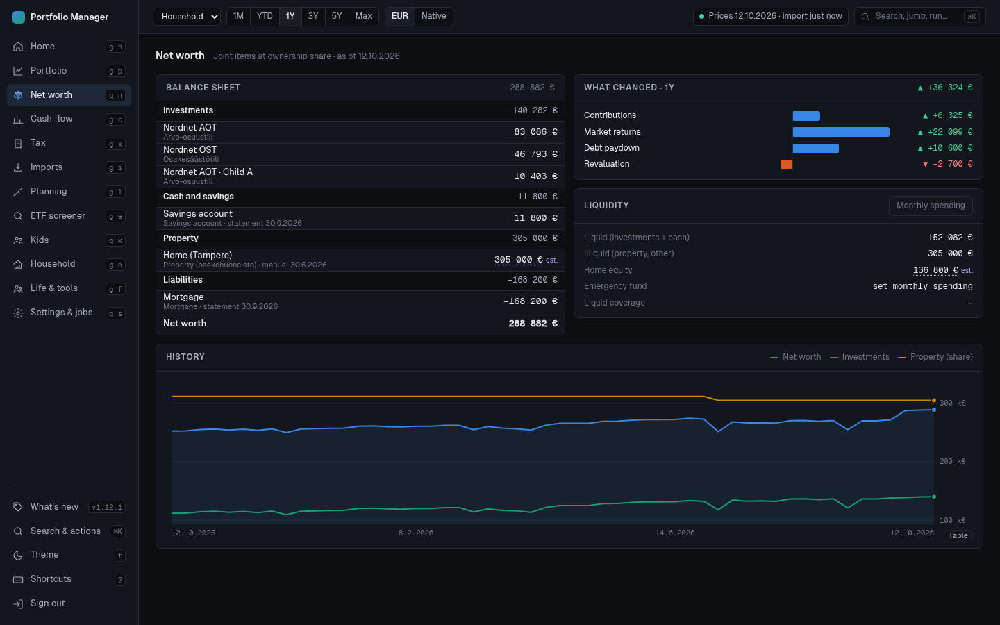
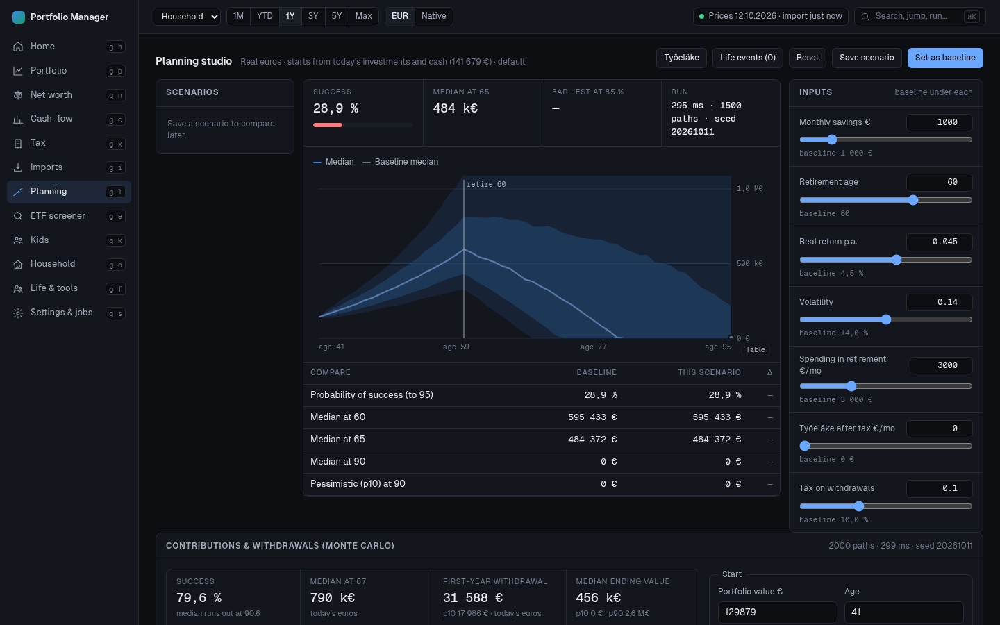
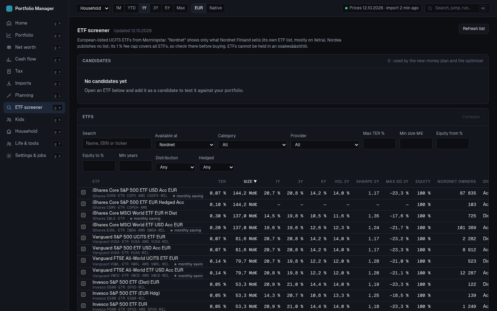
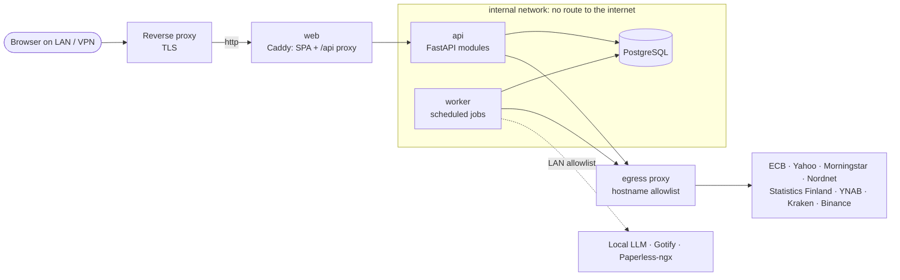

<div align="center">

# Portfolio Manager

**A self-hosted personal finance suite for a Finnish household.**<br>
Ledger · portfolio analytics · net worth · Finnish tax · planning · local AI

[](LICENSE)




</div>

Portfolio Manager keeps one trustworthy picture of a family's money: a double-entry ledger of every investment account, daily valuations, net worth with property and loans, Finnish tax, and plans for the decades ahead. It runs on your own server, stays inside your home network, and reads statements with a language model that also runs at home.

> **Private by design.** Reachable only from your LAN or VPN. Read-only towards banks and brokers: it never moves money or places trades. It talks to an explicit allowlist of public data sources and logs every outbound call. AI runs on your own local model; no financial data goes to a cloud AI.

<sub>All screenshots show an invented demo household.</sub>

## Screenshots

<table>
  <tr>
    <td width="50%"><br><b>Portfolio</b>: time- and money-weighted returns, holdings per account with FIFO cost and unrealised gains.</td>
    <td width="50%"><br><b>X-ray</b>: what you really own once every ETF and fund is opened up, and what it costs per year.</td>
  </tr>
  <tr>
    <td><br><b>Benchmarks and risk</b>: your return against world, S&amp;P 500, emerging markets and bond indices.</td>
    <td><br><b>Net worth</b>: balance sheet at ownership share, what changed and why, history.</td>
  </tr>
  <tr>
    <td><br><b>Planning</b>: Monte Carlo retirement plans with live what-if sliders and scenario comparison.</td>
    <td><br><b>ETF screener</b>: about 4 600 European UCITS ETFs, filtered to what your broker actually sells.</td>
  </tr>
</table>

## Features

<details open>
<summary><b>Portfolio and analytics</b></summary>

- Double-entry ledger with raw-first imports: every imported row is kept with a content hash, imports are idempotent, and corrections supersede rather than delete.
- Nordnet CSV import with staging, review, instrument mapping, corporate actions (splits, exchanges, redemptions) and row-level reconciliation.
- Holdings, FIFO cost basis, TWR and XIRR with dividends per account, person and household; income forecast; a dashboard per child.
- X-ray: true asset class, regions, countries, sectors, size, style, bond duration and credit, and fund costs (TER) in €/year, looking through every ETF and fund.
- Risk and correlations, benchmarks against a dozen indices, Fama-French factor analysis and portfolio optimisation.
- Allocation advisor that derives targets from the loss you can accept, glide paths, tax-aware rebalancing and a buy-only new-money plan with real broker fees.
- ETF screener with Nordnet availability; candidate ETFs feed the plans and the optimiser.
- Leverage (securities credit) and hedging without selling: puts, collars, mini futures and bear certificates compared on the same simulated paths.
</details>

<details>
<summary><b>Net worth, cash and property</b></summary>

- Household and per-person balance sheet with ownership shares, history and change decomposition.
- Property, housing-company loan, mortgage and other manual assets and liabilities; housing value from Statistics Finland indices; loan what-if scenarios; home equity against securities credit.
- Cash: ECB deposit and Euribor rates, your own offers, and an interest-ladder planner.
- YNAB sync (optional push back) or Actual Budget, spending analytics, housing costs from budget categories.
- Crypto: Kraken and Binance read-only APIs, public addresses, history imports (Kraken, Binance, Ledger Live, generic CSV).
</details>

<details>
<summary><b>Finnish tax</b></summary>

- Rule tables per year in `rules/`: capital income brackets, deemed acquisition cost (hankintameno-olettama), osakesäästötili, small-disposal rule, loss carry-forward, gift and inheritance tax.
- Year-to-date estimate with dividends, withholding and a country-by-country foreign tax credit capped at treaty rates.
- Tax-loss harvesting before year end, and a crypto report laid out like OmaVero's virtual-currency form.
</details>

<details>
<summary><b>Planning</b></summary>

- Pension (työeläke) estimate, deterministic and Monte Carlo projections, life events and inheritances, scenario comparison and stress tests.
- Contribution and withdrawal Monte Carlo on your own portfolio's history, tax-aware withdrawal order, fee analysis and backtests.
</details>

<details>
<summary><b>Local AI</b></summary>

- Reads uploaded statements (PDF, scans, screenshots, CSV, Excel) page by page through an OpenAI-compatible gateway on your LAN, checks the result against the page text and totals, and books it only after you review it.
- Extracts values from Paperless-ngx documents with the quoted source text, reads fund factsheets, and explains plans in plain language.
</details>

<details>
<summary><b>Life, estate and operations</b></summary>

- Subscriptions detected from budget data, vehicles, home maintenance, insurance register, goals and habits, a calendar with .ics export, and a health log.
- An encrypted emergency package (AES-256 PDF) for the family.
- Alerts and a weekly digest through Gotify and SMTP, attention list, audit log, outbound call log, nightly backups with a restore test, and a worker heartbeat.
- Keyboard-first interface with a command palette, dark and light themes, and an installable PWA.
</details>

## Architecture

A modular monolith: one FastAPI backend split into domain modules, one worker for scheduled jobs, PostgreSQL and a React single-page app, as five containers under Docker Compose.



- `web` is the only published container: plain HTTP on the LAN address `PM_BIND:PM_PORT`. TLS ends at a reverse proxy on your LAN. It serves the built frontend and proxies `/api`.
- `api`, `worker` and `db` sit on an internal Docker network with no internet route. Their only way out is the `egress` proxy, which allows HTTPS only to the hostnames in `PM_OUTBOUND_ALLOWLIST`. The app checks the same list and logs every outbound call (Settings, Connections).
- LAN services (Gotify, Paperless-ngx, the local AI gateway) are allowed through `PM_LAN_ALLOWLIST`. The worker also has a `mail` network for SMTP to private addresses.
- The local LLM is an OpenAI-compatible gateway configured with `PM_LLM_URL`.
- Data sources: ECB (FX), Yahoo (prices), Morningstar lt.morningstar.com (fund prices and fund data), Nordnet www.nordnet.fi (its public ETF list, for the screener), Statistics Finland (housing indices), YNAB, Kraken, Binance and CoinGecko. The default allowlist is written by `deploy/init-env.sh`.
- Money is `Decimal`, never float. Positions, lots, valuations and snapshots are derived from the ledger and can be recomputed.

Backend modules are in `backend/app/modules/`: core, ledger, ingest, pricing, portfolio, networth, cashflow, crypto, tax, planning, documents, alerts, ai, exports, home, vehicles, subscriptions, life, ux. Frontend screens: Home, Portfolio, Net worth, Cash flow, Tax, Life, Imports, Planning, Kids, Household, Settings.

## Quick start

Production is `deploy/compose.yaml`.

```sh
cd deploy
PM_BIND=192.168.1.10 ./init-env.sh  # once: writes deploy/.env with fresh secrets (never committed)
docker compose up -d --build        # deploy or upgrade all services together; migrations run when the api starts
docker compose ps                   # health
docker compose logs -f worker       # scheduled jobs
```

- `init-env.sh` generates `PM_MASTER_KEY` and the database password and writes the bind address (`PM_BIND`, this host's LAN address), port, outbound allowlist and optional LLM URL (`PM_LLM_URL`). Edit `.env` for your network: LAN services such as Gotify, Paperless-ngx or the LLM gateway go into `PM_LAN_ALLOWLIST`. Back `.env` up separately from the database dumps: without `PM_MASTER_KEY` the stored API tokens cannot be decrypted.
- Binding: `PM_BIND` (required) and `PM_PORT` (default `8640`). Do not put the app behind an internet-facing proxy.
- Auth modes (`PM_AUTH_MODE`): `login` is the default (username and password, optional TOTP). `network` signs requests in as the single owner when the connecting address and every `X-Forwarded-For` hop are in private ranges; a public address anywhere in the chain still requires sign-in.
- Reset a password: `docker compose exec api python -m app.cli reset-password <username>`.
- Ingress is restricted to private ranges by `deploy/firewall/pm-lan-only.sh` (systemd unit `pm-firewall.service`; set the path in `ExecStart` to your checkout).
- First run: open the app, create the owner account, then add people and accounts in Settings and import a Nordnet transaction export under Imports.

## Try it with demo data

`scripts/demo-seed.py` fills an empty instance with an invented household (the one in the screenshots): people, Nordnet accounts with seven years of monthly ETF saving, a home and a mortgage. Run it against the throwaway test stack, never against your real instance (it stops if an owner already exists):

```sh
cd deploy && PM_BIND=127.0.0.1 ./init-env.sh && ./e2e.sh up && cd ..
python3 scripts/demo-seed.py http://127.0.0.1:8650
# open http://127.0.0.1:8650 and sign in as "demo" / "demo-password-123"; prices arrive within a few minutes
./deploy/e2e.sh down   # removes the demo, including its data
```

## Development

`deploy/compose.dev.yaml` (project `pm-dev`) starts a throwaway Postgres on tmpfs and a `tools` container with the backend source mounted at `/srv/app`.

```sh
docker compose -f deploy/compose.dev.yaml up -d --build
docker exec -w /srv/app pm-dev-tools-1 ruff check .
docker exec -w /srv/app pm-dev-tools-1 mypy app
docker exec -w /srv/app pm-dev-tools-1 pytest
cd frontend && npx tsc --noEmit     # frontend type check
# vitest, in the same Node image as the web build (node_modules here are built for Alpine)
docker run --rm -u 1000:1000 -v "$PWD":/repo -w /repo/frontend -e HOME=/tmp node:22-alpine npx vitest run
```

- `deploy/e2e.sh up` starts a throwaway copy of the production stack as project `pm-e2e`, bound to `127.0.0.1:8650` with its own images, volumes and subnets, so it can run next to production. `deploy/e2e.sh down` removes it, including volumes.
- Backend: Python 3.12+, FastAPI, SQLAlchemy 2, Alembic (`backend/migrations/`). Frontend: Vite, React, TypeScript.

## Data, backups and restore

- `deploy/backup.sh` writes a `pg_dump` custom-format file to `$PM_BACKUP_DIR` (default `~/backups/portfolio-manager`) and removes dumps older than 30 days. Run it nightly from cron, for example at 02:00.
- `deploy/restore-test.sh` restores the newest dump into a throwaway `postgres:16-alpine` container (no ports, never the live database), checks `alembic_version` and the core tables have rows, and fails if the dump is more than 2 days old. It prints one `restore-test ok` or `restore-test FAILED` line. Run it monthly from cron: `30 3 * * 0 [ "$(date +\%d)" -le 07 ] && /bin/bash $HOME/portfolio-manager/deploy/restore-test.sh >> $HOME/backups/portfolio-manager/restore-test.log 2>&1` (first Sunday, 03:30).
- `deploy/restore.sh <file.dump>` stops the app, drops and recreates the database, restores the dump and starts the app again. It destroys current data.
- Keep a copy of the dumps off the host as well.
- Back up `deploy/.env` separately.

## Versioning and releases

The project uses [Semantic Versioning](https://semver.org/). A release is a git tag `vX.Y.Z` on `main`. [CHANGELOG.md](CHANGELOG.md) is the single source of release notes; the app shows it under "What's new", so keep its format exact (see the header of that file).

To release:

1. Move the entries under `## [Unreleased]` to a new heading `## [X.Y.Z] - YYYY-MM-DD` and leave an empty `## [Unreleased]` above it.
2. Bump the version in `frontend/package.json` (a frontend test checks it matches the newest changelog release), `backend/pyproject.toml` and `backend/app/__init__.py`.
3. Commit.
4. Tag: `git tag vX.Y.Z`.
5. Push `main` and the tag: `git push origin main vX.Y.Z`, then deploy (`cd deploy && docker compose up -d --build`, all services together).

Write entries for the app's user (what they can now do), as single `- ` lines under `### Added`, `### Changed`, `### Fixed`, `### Removed` or `### Security`.

## Repository layout

```
backend/     FastAPI app (app/modules, app/platform), Alembic migrations, tests
frontend/    Vite + React + TypeScript SPA (src/screens, src/components)
deploy/      compose files, Caddyfile, egress proxy, firewall unit, backup/restore/e2e scripts
rules/       Finnish tax rule tables per year (YAML)
fixtures/    sample exports used by tests
scripts/     demo data generator
```

## Disclaimer

This is a personal project, shared as is. Tax, pension and planning figures are estimates built from published Finnish rules and your own inputs; they are not financial, tax or legal advice, and the rule tables in `rules/` may be out of date. Check anything that matters against vero.fi, your bank or an adviser.

The app reads prices and fund data from public but unofficial endpoints (Yahoo Finance, Morningstar, Nordnet). They can change or stop working at any time, and their terms of use apply to you. The app never moves money or places trades.

## Licence

[PolyForm Noncommercial 1.0.0](LICENSE): free to use, change and share for any noncommercial purpose, including personal use. Commercial use is not permitted.
